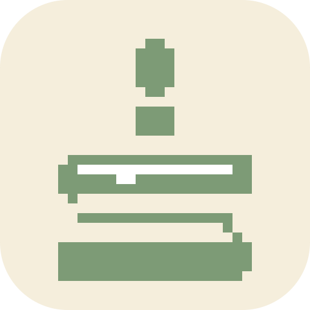

<div align="center">
  <a href="#a-surprise-for-stephanie">
    
  </a>
  <h1>Stephanie's Birthday Cake</h1>
  <p>A little cake. A big wish. Made for Stephanie's 20th birthday.</p>
  <p><strong>Sage Green · Cream · White</strong></p>
  <p>
    <a href="#a-surprise-for-stephanie">Open the surprise</a> ·
    <a href="#the-birthday-experience">Explore the experience</a> ·
    <a href="#run-locally">Run locally</a>
  </p>
</div>

## A surprise for Stephanie

Made especially for **Stephanie**, with her favorite color, green, at the heart of the design. The planned experience pairs a softly lit 3D cake with glowing **2** and **0** candles, a birthday wish, and a small celebration.

<details>
<summary>🎁 Stephanie, open your birthday message</summary>

> Happy Birthday, Stephanie!
> May all your wishes come true. ✨

</details>

<details>
<summary>🍰 Meet the cake behind the logo</summary>

The pixel-art cake forms an **S for Stephanie**, topped with a candle. A rounded cream tile holds the sage green silhouette and white frosting accent.

| Logo color | HEX | Role |
| --- | --- | --- |
| Sage green | `#7D9B76` | Cake and candle |
| Cream | `#F5EEDC` | Background |
| White | `#FFFFFF` | Frosting accent |

[View the SVG](design/logo/concept-c-v1-pixel-sage-rounded-round.svg) · [View the PNG](design/logo/concept-c-v1-pixel-sage-rounded-round.png) · [Compare rounded versions](design/logo/rounded-comparison.png)

The selected rounded logo is also the site's browser favicon. These HEX values describe the logo; application colors still need contrast checks during implementation.

</details>

## The birthday experience

**In development:** the logo, favicon, and requirements are ready. The home page is still the Next.js starter; the interactive cake, microphone detection, music, and celebration below are planned features.

<details>
<summary>🕯️ 1. Meet the birthday cake</summary>

A round 3D cake with a cream base, white frosting, sage green decorations, and two lit numeral candles: **20**. Designed first for phone portrait screens, with desktop support too.

</details>

<details>
<summary>🌬️ 2. Make a wish and blow</summary>

Choose to enable the microphone, then blow to extinguish both candles together. Audio will be analyzed locally without recording, storing, or uploading it. A manual blow button will offer the same celebration without microphone access.

Blow detection is a heuristic and will need real microphone testing; speech and room noise may affect it.

</details>

<details>
<summary>✨ 3. Watch the surprise unfold</summary>

The flames fade, a brief smoke effect appears, and a short confetti burst reveals Stephanie's birthday greeting. The cake and message stay visible afterward. Refreshing the page starts a fresh celebration.

Reduced-motion preferences and a usable fallback when 3D rendering is unavailable are part of the planned experience.

</details>

<details>
<summary>🎵 What about the music?</summary>

Soft birthday instrumental music will start only through a user action, with Play/Mute controls. Playing music will pause while the microphone listens, then return according to the user's previous playback choice.

A licensed music asset has not been selected yet.

</details>

### Progress

- [x] Confirm Stephanie's birthday experience and greeting
- [x] Design the sage green pixel-art cake logo
- [x] Add the selected rounded logo as the browser favicon
- [ ] Build the responsive 3D cake and animated candles
- [ ] Add local microphone detection and the manual blow action
- [ ] Add music controls and a licensed instrumental track
- [ ] Add smoke, confetti, and the birthday greeting
- [ ] Verify accessibility, fallbacks, and real-device behavior

## Run locally

Use **npm** with the committed lockfile and a supported Node.js LTS release that meets Next.js's minimum of **20.9.0**.

```bash
npm ci
npm run dev
```

Open [localhost:3000](http://localhost:3000). At this stage, it displays the starter page with the custom birthday favicon.

<details>
<summary>🛠️ Development commands and stack</summary>

| Command | Purpose |
| --- | --- |
| `npm run dev` | Start the development server |
| `npm run lint` | Run ESLint |
| `npx --no-install next typegen` | Generate route types before standalone type-checking |
| `npx --no-install tsc --noEmit` | Check TypeScript |
| `npm run build` | Create the production build |
| `npm start` | Serve the production build |

The installed stack includes Next.js App Router, React, TypeScript, Tailwind CSS, Three.js, React Three Fiber, Drei, and Motion. Planned microphone analysis uses the browser's Web Audio API.

There is no configured test runner yet. Builds currently use Google fonts and may need network access to fetch them.

</details>

## Project notes

- [Confirmed requirements](docs/requirements.md) — the agreed birthday flow, music behavior, and acceptance checklist.
- [Domain glossary](GLOSSARY.md) — shared terms used throughout the project.
- [Development guide](AGENTS.md) — architecture, browser boundaries, and verification rules.
- [Logo files](design/logo/) — selected artwork and rounded variants.

<div align="center">
  <p>Made for Stephanie. A little birthday wish, made with care.</p>
  <a href="#stephanies-birthday-cake">Back to top ↑</a>
</div>
